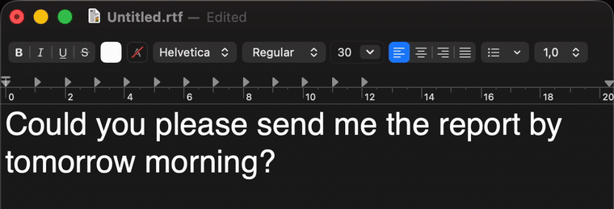

<div align="center">


# Easy Write on Mac

### Translate & rewrite text anywhere on your Mac — formal or informal — 100% on-device.

Select text in any app, press a shortcut, and it's **replaced in place** with the translation, in the
tone you choose (German *Sie* vs *du*, French *vous* vs *tu*, …). Or run your own actions: fix the
grammar, make it shorter, reply politely. Powered entirely by Apple's **on-device** model (Apple
Intelligence). **No accounts. No API keys. No cloud.** Your text never leaves your Mac.

**Easy Write 2.0.** [Download free for macOS](https://github.com/onekapisch/easy-write/releases/download/v2.0/EasyWrite-2.0.dmg).
Developer-ID signed and notarized. Requires Apple Silicon, macOS 26+, and Apple Intelligence ready.
See [launch status](docs/launch-handoff.md) for verification evidence and compatibility limits.


**[🧠 How it works](HOW_IT_WORKS.md) · [⬇️ Install](#️-install) · [🆚 How it compares](#-how-it-compares) · [🐛 Report a bug / request a feature](../../issues)**



</div>

---

## Why Easy Write?

If you write emails, messages, or docs in a language that isn't your first, you're stuck in a loop:
copy → open a translator website → paste → translate → copy → paste back. And the result often gets
the *words* right but the **tone** wrong — which in German (and French, Spanish, Italian…) is the
difference between polite and rude.

- 🌐 **Cloud translators** mean sign-ups, monthly limits, and your private text leaving your machine.
- 🧩 **Local LLM tools** get privacy right but make you install Ollama, download a model, or paste in
  an API key first.

**Easy Write uses the AI already built into macOS 26** — so it's private *and* there's nothing to set
up, and it understands formality, which a plain dictionary translator can't.

## What's new in 2.0

- 🔎 **Easy Write Bar** (`⌥⌘K`) — every language, tone and action next to your selection. Type to
  filter, or type any instruction and run it once. The result streams in before anything changes.
- 🔁 **Both directions with one key** — `⌥⌘T` translates into your target language, or back into
  yours if the text is already in it.
- 🧠 **Remembered per app** — formal in Mail, informal in Slack, without touching a setting.
- ✨ **Actions** — your own instructions on a shortcut, shareable as a link.
- 🏝️ **Notch HUD** — progress and results right at the top of the screen, with ⌘Z to undo.
- 📥 **Notarized installer** with optional update checks. Installed automatic upgrades remain unverified.

See the full [changelog](CHANGELOG.md).

## What you get

- ⚡ **Translate in place** — select → shortcut → replaced, in any app
- 🗣️ **Formal / informal / natural** — German *Sie* vs *du*, French *vous* vs *tu*, Spanish *usted* vs *tú*…
- 📖 **Read mode** — translate text you can't edit into your own language, in a card you can pin or have read aloud
- 🌍 **13 languages** — German, French, Spanish, Italian, Portuguese, Dutch, Turkish, Polish, Russian, English, Japanese, Chinese, Arabic
- ✨ **Actions** — Fix grammar, Make it shorter, Reply politely, Explain the grammar, Sound native, Japanese keigo, or write your own
- 📚 **Glossary & style notes** — exact terms and your preferences in every result
- 🕘 **Opt-in history**: originals and results stay local; disabling it deletes the history file
- ⌨️ **Custom shortcuts** — rebind everything
- ♿️ **VoiceOver** — labelled controls and spoken results
- 🔒 **Local AI** — no account, no API key, no telemetry; optional updates and external links use the network, never your selected text

## 🆚 How it compares

The honest version: these tools are good — Easy Write just occupies a different corner (free,
private, nothing to set up, register-aware).

| | **Easy Write** | DeepL | Google Translate | Apple Translate | Ollama-based tools |
|---|:---:|:---:|:---:|:---:|:---:|
| Runs on-device / private | ✅ | ❌ cloud | ❌ cloud | ✅ | ✅ |
| No account or API key | ✅ | ❌ | ⚠️ | ✅ | ⚠️ needs setup |
| Formal vs informal (Sie/du) | ✅ | Pro only | ❌ | ❌ | ✅ |
| Replace selection in place | ✅ | app only | ❌ | ✅ | varies |
| Cross-app text access | supported Accessibility fields | ✅ | ❌ | ⚠️ some | varies |
| Your own rewrite actions | ✅ | ❌ | ❌ | ❌ | varies |
| Setup | manual DMG install, or source build | account | — | built-in | install Ollama + model |
| Open source | ✅ | ❌ | ❌ | ❌ | ✅ |
| Price | **Free** | Free / Pro | Free | Free | Free |

## Requirements

- **macOS 26 (Tahoe) or later** on **Apple Silicon**
- **Apple Intelligence turned on** — System Settings → *Apple Intelligence & Siri*

## ⬇️ Install

**Official manual DMG install (2.0, build 24).**

1. Quit any running copy of Easy Write or EasyWrite before installing or upgrading.
2. Download [EasyWrite-2.0.dmg](https://github.com/onekapisch/easy-write/releases/download/v2.0/EasyWrite-2.0.dmg),
   open it, and drag **Easy Write.app** to **Applications**. Replace the existing copy if prompted.
3. Launch **Easy Write** from Applications. Grant access in System Settings → Privacy & Security →
   Accessibility. If an old grant no longer works, remove the stale entry and enable the installed copy.
4. Enable Apple Intelligence and wait until its model is ready. The welcome window checks
   Accessibility and model readiness, then offers a practice swap. Use disposable text first.

The installer is 3,987,107 bytes. SHA-256:
`586ab04082d3542d4796d3b930b15f750f01a1e44c0c760569b346a438ed4c6c`.
The [product page](https://www.onekapisch.com/products/easy-write/) is the canonical site.
Homebrew is **not live**; no Homebrew installation is offered for this launch.

**Build from source (still supported).** Default source builds disable update configuration.
Use the version tag below to build this release.

```bash
git clone https://github.com/onekapisch/easy-write.git
cd easy-write
git checkout v2.0
./setup-signing.sh      # once, if you don't have a Developer ID: keeps the Accessibility grant across rebuilds
./build.sh              # compile + bundle + sign → "Easy Write.app"
cp -R "Easy Write.app" /Applications/
open "/Applications/Easy Write.app"
```

**Upgrading from 1.x?** Install the DMG manually: pre-Sparkle 1.x cannot receive this upgrade
automatically. Your settings move over automatically. macOS asks for Accessibility again
because the app is now signed by OneKapisch. If the old "EasyWrite" entry is still in
System Settings → Privacy & Security → Accessibility, remove it, then delete the old
`EasyWrite.app` from Applications. Optional update checks in 2.0 concern future releases and
require consent; a successful installed Sparkle upgrade has not yet been verified.

## Usage

| Shortcut | Action |
|:---:|---|
| `⌥⌘K` | Open the **Easy Write Bar** next to your selection |
| `⌥⌘T` | **Translate** — into your target language, or back into yours |
| `⌥⌘E` | **Read** — translate into your language in a card (for text you can't edit) |
| `⌥⌘G` | **Fix grammar** (a built-in action) |
| `⌃⌥R` | **Reply politely** (a built-in action) |

Click the menu-bar icon for the panel: status, your target language and tone, and quick tiles. Every
shortcut can be changed in **Settings → Shortcuts**, and any action can get one.

## 🔒 Privacy & security

Your text never leaves your Mac. The model runs locally; there is no analytics, no telemetry, and no
account. Optional update checks and downloads contact the website and GitHub; they send no selected
text, but those servers can observe ordinary request metadata, including your IP address and app
version. The permission it needs is **Accessibility**, to
read your selection and paste the result back. Your clipboard is restored
after temporary pastes while Easy Write still owns it; newer clipboard copies are preserved.
Clipboard-manager behavior varies. Opening Studio, support or shared-action links visits the
destination in your browser and exposes normal browser request metadata.

Automatic replacement requires the original window, field, selection range and text to remain
verifiable. Otherwise the result appears for review instead of being pasted. The HUD says
"Paste sent" because synthetic keystrokes have no delivery acknowledgement.

History is off by default, including upgrades from early 2.0 previews. Opting in stores originals
and results as unencrypted local JSON. Disabling deletes that file. Expired entries are removed
every minute while running, after wake, and on the next launch. Backups may retain earlier copies.

See [SECURITY.md](SECURITY.md) for the full data flow, what's stored where, and how to report a
vulnerability.

## 🧠 How it works

See **[HOW_IT_WORKS.md](HOW_IT_WORKS.md)** — the on-device LLM, the permissive-guardrails gotcha, the
in-place swap, the Bar that types without stealing focus, the notch HUD, two-way language detection,
and how shared actions stay safe.

## Roadmap

**2.1 — Screen Translate:** drag over any part of the screen (an image, a video subtitle, a scanned
PDF) and read it in your language, on-device. Ideas and PRs welcome — open an [issue](../../issues).

## FAQ

**Is it really free?** Yes — free and open source (MIT). No account, no subscription, no upsell.

**Does it send my text anywhere?** No selected text is sent by Easy Write. AI processing stays
on your Mac. Optional update checks include the app version; hosting services can also observe
ordinary HTTP metadata such as your IP address. External links open in your browser.

**Why does it need Accessibility permission?** To read your current selection and paste the result
back using macOS APIs. The app must expose its selected text through Accessibility. If it does
not, capture fails safely instead of using unrelated clipboard contents.

**Why not the Mac App Store?** Posting keystrokes to other apps is incompatible with App Store
sandboxing. Source builds remain supported; the official notarized DMG launch is approved
and publication is in progress.

**"Apple Intelligence is still preparing."** Apple Intelligence is on but still downloading its model
— that happens the first time you turn it on and can take a while. Wait until System Settings →
*Apple Intelligence & Siri* shows it's ready (it needs free storage and a network connection). The
panel and the welcome window update on their own when it's done.

**How is this different from Apple's built-in Translate or Writing Tools?** Apple's Translate opens
a popover you copy from and can't do formal vs informal. Writing Tools rewrites through a menu.
Easy Write is one keystroke in any app, translates with the right tone, and runs your own actions.

## Contributing

**Website research and guides:** the [23 October search strategy](docs/seo/2026-10-23/SEO-STRATEGY.md)
includes a qualitative keyword map, competitor fact check, content architecture and 90-day plan.
Its six guide drafts are dated editorial snapshots. Deployable copies belong to the OneKapisch
website's `studio-fable/content/easy-write/` collection. This work does not publish the website
or release a 2.0 binary, and does not establish translation-quality or user-outcome claims.

**2.0 launch media:** [asset guide](launch-assets/v2/README.md),
[local gallery](launch-assets/v2/gallery.html), and [website proposal](launch-assets/v2/WEBSITE-REDESIGN.md).
Reproduce the native screenshots and owned-window HUD recording with
`bash tools/launch-assets/export.sh`. These synthetic demos are not translation benchmarks.

PRs and issues welcome — see [CONTRIBUTING.md](CONTRIBUTING.md). Run `EasyWrite --selftest` before
opening a PR, and `--eval` for any prompt or language change.

## License

[MIT](LICENSE) © onekapisch

---

<div align="center">

⭐ **If Easy Write saves you a trip to a translation site, star the repo — it genuinely helps other people find it.**

Made with Swift + Apple's on-device intelligence · No cloud, no accounts, no tracking.

</div>
